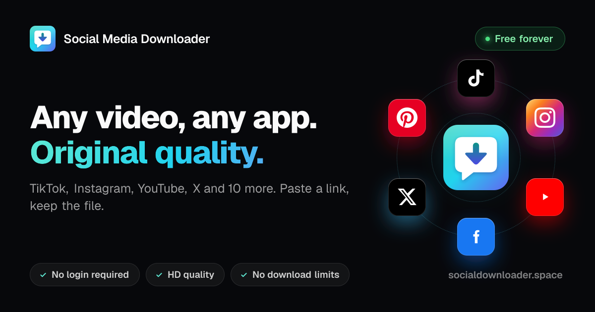

# Social Media Downloader

> Download public TikTok, Twitter/X, Instagram, Facebook, YouTube, Pinterest, Reddit, Threads, Snapchat, Twitch, Vimeo, Dailymotion, LinkedIn & Telegram posts in their original quality — HD video, reels, Shorts, MP3 audio, photo carousels, and ffmpeg-rendered slideshow MP4s. Free, no login, no limits. Installs as an app.



[](https://nextjs.org)
[](https://react.dev)
[](https://www.typescriptlang.org)
[](https://tailwindcss.com)
[](https://web.dev/progressive-web-apps/)
[](../../releases)
[](LICENSE)

### 🚀 [Try it live →](https://www.socialdownloader.space)

### 🎬 Watch the 26-second film

https://github.com/user-attachments/assets/ebd6e5d9-a3b6-45e2-b8e2-c8ab2dbd2196

**Vertical 9:16**, for Reels, TikTok and Shorts:

https://github.com/user-attachments/assets/68528890-a25f-4f5a-8ded-44c69f1c75ce

[1080p, 16:9](docs/films/smd-film-1080p60.mp4?raw=true) · [vertical 9:16 for Reels, TikTok and Shorts](docs/films/smd-reel-9x16-60.mp4?raw=true). Both are 60 fps, cut to their own soundtrack and built from the live site's real screens ([`video/`](video/README.md)).

## 📣 Sponsor this project

**Put your brand in front of people saving videos from every major app, at the moment the download lands.** One sponsor card per download, shown after the result. No popups, no redirects, no ad network, nothing in the way of the file.

### 📧 [Email booogado@gmail.com to book the slot](mailto:booogado@gmail.com?subject=Downloader%20sponsor%20slot&body=Hi%2C%20I%20would%20like%20to%20sponsor%20Social%20Media%20Downloader.%0A%0ACompany%20and%20website%3A%0AAffiliate%20%28referral%20link%20%2B%20coupon%29%20or%20a%20fixed%20month%3A%0AMonth%28s%29%20wanted%3A%0ACoupon%20code%20and%20what%20it%20gives%3A%0A)

Affiliate link with your coupon, or a fixed month. You get a monthly report of shows and clicks. [Slot details →](#supporting-the-project)

A free downloader for public posts on **TikTok, Twitter/X, Instagram, Facebook, YouTube, Pinterest, Reddit, Threads, Snapchat, Twitch, Vimeo, Dailymotion, LinkedIn and Telegram**. Paste a link and get an HD video, reel, or Short, MP3 audio, a photo carousel (individual images or a ZIP), or a fully rendered slideshow MP4 with the original soundtrack. No login and no install are required, and it runs in your browser. It reaches only what a logged-out visitor can already see: no private accounts, no paywalled or subscriber-only posts, no DRM.

It's also an **installable app (PWA)**: add it to your home screen and share links straight from the TikTok, Instagram, or YouTube app, with no browser and no copy-paste. Prefer chat? The same downloader runs as a **Telegram bot**, [@SocialDownloaderSpaceBot](https://t.me/SocialDownloaderSpaceBot): send it a link, get the file back.

The site speaks **English, Arabic (right-to-left), Spanish, Portuguese and Indonesian**, each with its own localized landing pages and share cards.

Open source, with no popups, no redirects, no tracking, and a multi-source fallback chain so downloads keep working when any single provider goes down.

⭐ If this tool is useful to you, please [star the repo](https://github.com/Vette1123/social-media-downloader/stargazers). It helps others find it.

Built with Next.js 16, React 19, TypeScript 7, Tailwind CSS 4, and Motion 14 by [Mohamed Gado](https://www.mohamedgado.com).

## Why use it

- 14 platforms, one paste box. TikTok, X, Instagram, Facebook, YouTube, Pinterest, Reddit, Threads, Snapchat, Twitch, Vimeo, Dailymotion, LinkedIn and Telegram, auto-detected from the URL.
- Any other link too. Paste a URL from anywhere else and the extractor still goes to work: it reads whatever media the page publishes (og:video, JSON-LD, player configs, download links), with a self-hosted yt-dlp resolver behind it for everything stricter. If the page serves its media to the public, this usually resolves it.
- Original quality, HD by default. The source file with no re-encode, a one-tap fallback to SD, and MP3 audio extraction wherever a stream resolves.
- No login, no API key, no daily limit. Nothing to sign up for and nothing installed unless you want the app.
- Private by design. No account is needed to download and nothing logs what you download. A Google sign-in exists so preferences can sync and so supporters' extras can be attached to an account. Your Recent list lives in your own browser.
- Resilient. A per-platform fallback chain retries other sources, so a single provider outage doesn't break your download.
- Installable PWA. Home-screen icon, app shortcuts, and native share-in from other apps.
- Telegram bot. Send a link to [@SocialDownloaderSpaceBot](https://t.me/SocialDownloaderSpaceBot) and the file comes back in the chat.
- Five languages. English, Arabic (RTL), Spanish, Portuguese and Indonesian.

## Features

### Platforms

**TikTok**

- HD video downloads at the source quality
- Extract the soundtrack as MP3 (re-served with `audio/mpeg`)
- Photo carousels (slideshows): preview every image, save individually or as a ZIP, keep the original background music
- Render a TikTok slideshow into a real MP4 video (ffmpeg) when the platform only ships images

**Twitter / X**

- Native video and GIF extraction from any `twitter.com` or `x.com` status URL
- Resolves `t.co` short links

**Instagram**

- Download reels and feed videos in their original quality
- Save single-photo posts and multi-image carousels — individually or as a ZIP
- Extract the audio track from a reel as MP3
- Works with `instagram.com/p/…`, `/reel/…`, `/tv/…` and share links — no login required
- Posts Instagram will not serve logged-out (private, age- or region-restricted) need `IG_SESSIONID` *and* the `ig` grant, and are the only Instagram links that fail

**YouTube**

- Download videos and Shorts in HD as MP4
- Extract the audio track as MP3
- Metadata (title, channel, thumbnail) pulled from YouTube's public oEmbed
- Works with `youtube.com/watch?v=…`, `youtu.be/…`, `/shorts/…`, and `/embed/…`

**Facebook**

- Download public videos, watch clips, and reels in HD
- Extract the audio track as MP3
- Resolves `fb.watch/…` short links and `/share/…` links automatically
- A share link Facebook only shows to signed-in viewers gets a clear message saying so, instead of a generic failure
- Works with `facebook.com/…/videos/…`, `facebook.com/watch/?v=…`, and `facebook.com/reel/…`

**Pinterest**

- Download Pin videos and images from `pinterest.com/pin/…` (and `pin.it` short links)

**Reddit**

- Download videos from `reddit.com/r/…/comments/…` posts and `/s/…` share links

**Threads**

- Download videos, photo posts and carousels from `threads.net` / `threads.com` posts and their share links

**Snapchat**

- Download Spotlight clips and public story/profile media

**Twitch**

- Download clips from `twitch.tv/…/clip/…` and `clips.twitch.tv/…` (past broadcasts are HLS-only and not supported)

**Vimeo**

- Download videos from `vimeo.com/…` and `player.vimeo.com/…` via a dedicated extractor

**Dailymotion**

- Download videos from `dailymotion.com/video/…` and `dai.ly/…`

**LinkedIn**

- Download videos from public posts at `linkedin.com/posts/…`, `linkedin.com/feed/update/…` and `lnkd.in/…`; posts that need a login can't be fetched

**Telegram**

- Download the clip or photos from public channel posts at `t.me/<channel>/<id>`, `t.me/s/…` and `telegram.me/…`; private chats, groups and non-public channels can't be fetched

**SoundCloud**

- Public tracks at `soundcloud.com/<artist>/<track>`, best-effort through the Cobalt chain, saved as MP3

**Any other site**

- Paste any public link. The generic chain reads the page's own media (og:video, JSON-LD `contentUrl`, `<video>` sources, inline player configs, download anchors), verifies it serves a file rather than an error page, and offers it
- Sites that wall datacenter IPs are retried at an address they do answer (host-specific recipes read the embed/player page, which usually stays open when the watch page does not); a relay chain and an optional self-hosted yt-dlp resolver (`deploy/resolver/`) sit behind that, but note the free relays now refuse Worker-origin fetches, so on Cloudflare only a configured unlocker or resolver adds anything
- MP3 extraction works on this long tail too: when no audio-specific source answers, the resolved video stream is re-served through the audio route
- Where native binaries exist (self-hosting, local dev), a full yt-dlp extractor runs as the final fallback for pages whose players defeat tag-scraping — automatically absent on Cloudflare, where it short-circuits to null

### App experience

- **Installable PWA** — add to your home screen and launch it like a native app (standalone, own icon, splash).
- **Share Target (Android)** — installing registers the app as a share destination, so you can hit **Share → Social Downloader** from inside TikTok/Instagram/YouTube and land straight on a resolved download. No browser, no paste.
- **App shortcuts / jump list** — long-press the installed icon to jump straight to the TikTok, X, Instagram, YouTube, or Facebook downloader.
- **iOS add-to-home hint** — a nudge with the exact "Share → Add to Home Screen" steps, plus an iOS save hint on results.
- **One-tap paste** — reads the clipboard and resolves the link in a single tap.
- **Batch paste (supporter)** — drop a whole list of links (one per line or space-separated); every URL is pulled out, de-duplicated, and resolved in turn with live progress, across 1–3 parallel lanes.
- **Collection import (supporter)** — paste a YouTube `playlist?list=…`, a subreddit or Reddit profile, a Pinterest board, or a Vimeo channel once and it expands into batch rows, capped and de-duplicated, no re-pasting.
- **Subtitle download (supporter)** — every caption track on a resolved YouTube video saves as an SRT or WebVTT file, manual and auto-generated languages included; your language is remembered and syncs with your account.
- **Thumbnail save** — the cover image of any result saves as its own file.
- **Recent export/import** — the local history leaves the device as plain JSON and merges back in on another one (newest wins), staying local-first either way.
- **Result re-pick** — switch a resolved result between **HD / SD / MP3** without re-pasting; your choice is remembered for the next link.
- **Recent** — a local, privacy-friendly history of what you've grabbed (branded per-platform tiles, "View all"), stored only in your browser and re-resolvable in one tap. Never stores the short-lived CDN/stream URL.

- **Telegram bot** — [@SocialDownloaderSpaceBot](https://t.me/SocialDownloaderSpaceBot) resolves the same links in chat (`src/lib/telegram.ts`, webhook at `/api/telegram`).
- **Five languages** — every page in English, Arabic (full RTL), Spanish, Portuguese and Indonesian under `/<lang>/…`, with localized OG cards and hreflang.
- **Account page** — sign in with Google to sync preferences and see your supporter status.

### Quality of life

- Inline video and image previews before downloading
- Multi-source fallback chain per platform (resilient against any single provider going down)
- Warm-instance resolve cache and direct tunnel downloads for faster, lighter fetches
- CORS-proxied media routes so downloads (and Instagram's hotlink-protected CDN) work cross-origin, with HTTP range support for seek/preview
- Inline URL validation, motion animations, responsive layout, low-power/touch-aware effects
- Fifteen SEO-tuned landing pages (one per platform, plus a general video downloader), each in five languages
- SEO: dynamic OpenGraph and Twitter card images, per-platform OG images, JSON-LD (WebSite, Person, SoftwareApplication, HowTo, FAQPage), hreflang, sitemap, IndexNow ping on build, and a PWA-tuned manifest
- No registration, no API keys, no daily limit

## Supporting the project

The site is free and stays free. It is paid for by one sponsor card shown
after a download, and by its supporters. There are no popups, no redirects, no
interstitials, and no tracking of what you download.

**Sponsor the slot.** One sponsor holds the card for a calendar month, paid per
order through your affiliate link or as a fixed month. Your coupon goes on the
card, and you get a monthly report of shows and clicks.
**[Email booogado@gmail.com to book it](mailto:booogado@gmail.com?subject=Downloader%20sponsor%20slot&body=Hi%2C%20I%20would%20like%20to%20sponsor%20Social%20Media%20Downloader.%0A%0ACompany%20and%20website%3A%0AAffiliate%20%28referral%20link%20%2B%20coupon%29%20or%20a%20fixed%20month%3A%0AMonth%28s%29%20wanted%3A%0ACoupon%20code%20and%20what%20it%20gives%3A%0A).**

Sponsor lines in this README end on their own date: `pnpm sponsors:expire`
removes an expired one, and CI runs it daily.

<!-- sponsor:proxy-seller until=2026-12-13T12:00:00Z -->
This month's sponsor is [Proxy-Seller](https://proxy-seller.com/?partner=YCKV39B16YFQUX): residential, mobile, ISP and datacenter proxies with HTTP(S) and SOCKS5. Code `SMD15` takes 15% off.
<!-- /sponsor:proxy-seller -->

**Support it yourself.** Supporting is a donation: $5 a month, $50 for a year,
or $99 once for life. [Email booogado@gmail.com](mailto:booogado@gmail.com?subject=Downloader%20supporter%20%E2%80%94%20Any%20plan) and the reply has how to pay.
The extras (batch queue, ZIP bundling, priority resolve, no sponsor card) are
on for the email you sign in with once the payment is done. See
[the support page](https://www.socialdownloader.space/pro).

## Tech stack

| Layer            | Technology                          |
| ---------------- | ----------------------------------- |
| Framework        | Next.js 16 (App Router), React 19   |
| Language         | TypeScript 7 (native `tsc` for typecheck; lint parses on TS 6) |
| Styling          | Tailwind CSS 4                      |
| Animation        | Motion (formerly framer-motion) 14  |
| UI primitives    | Radix Accordion, `clsx`             |
| Icons            | Hand-rolled SVG (`src/components/icons.tsx`) |
| Hosting          | Cloudflare Workers — static export + a hand-written Worker for `/api/*` |
| Accounts         | Google OAuth (PKCE, no SDK) + Cloudflare D1 |
| Entitlements     | Hand-set grants in D1 + signed short-lived tokens |
| HTTP             | Native `fetch` (`src/lib/httpClient.ts`) |
| HTML scraping    | Regex extractors (`src/lib/htmlExtract.ts`) |
| ZIP bundling     | JSZip, lazily imported **in the browser** |
| Slideshow video  | ffmpeg via @ffmpeg-installer *(Node hosts only)* |
| YouTube fallback | youtube-dl-exec *(Node hosts only)* |
| Dynamic OG       | `next/og`, prerendered to PNG at build time |
| App shell        | PWA manifest + Share Target + shortcuts |

Four of these are deliberate removals: Axios
(~half the CPU of `/api/download`; see `src/lib/httpClient.ts`), Cheerio
(too slow for the Worker CPU budget), lucide-react (three icons, hand-copied
paths), and arctic (41% of the Worker bundle to reach one OAuth provider).
Nothing in the deployed Worker comes from `node_modules` any more. Adding a
dependency that the Worker imports is a CPU decision — run `pnpm cf:startup`.

## Getting started

**Prerequisites:** Node.js 22+ (what CI runs), pnpm.

```bash
git clone https://github.com/Vette1123/social-media-downloader.git
cd social-media-downloader
pnpm install
pnpm dev
```

Open <http://localhost:3000>.

Build for production:

```bash
pnpm build && pnpm start
```

### Environment variables

All optional. The app runs without any config. Signing in and Pro billing are
themselves optional: without the accounts/billing variables below, the site
still works as a fully anonymous, free downloader; sign-in simply is not
offered.

They all live in one gitignored `.env`, copied from `.env.sample`. Next reads it
for `next dev` and `next build`, wrangler reads it for `wrangler dev`, and
`pnpm cf:setup secrets` uploads the deploy-relevant half to the Worker — so a
value is set once rather than kept in step across three files. Do not add a
`.dev.vars`: wrangler prefers that file and then ignores `.env` entirely.

| Variable              | Purpose                                                                          |
| --------------------- | -------------------------------------------------------------------------------- |
| `NEXT_PUBLIC_SITE_URL`| Canonical site URL used for metadata, sitemap, and OG images.                    |
| `COBALT_API_URL`      | Self-hosted [Cobalt](https://github.com/imputnet/cobalt) instance to harden the extraction fallback chain. |
| `IG_SESSIONID`        | Instagram session cookie from a burner account. Public posts resolve without it. Setting it is **not** sufficient on its own: a request also needs the `ig` grant on its user row, so an unlisted visitor never carries the cookie. Never sold, never bundled with the supporter grant — see below. |
| `FB_COOKIE`           | Whole `Cookie` header of a logged-in Facebook session, burner account preferred. Sent only for accounts with the `ig` grant, and only after every anonymous route fails. Paste it into `.env.fb-cookie`, then `pnpm fb:secret` uploads it and deletes the file. |
| `NEXT_PUBLIC_CF_BEACON_TOKEN` | Enables Cloudflare Web Analytics by injecting the beacon script at build time. Build-time only, like `NEXT_PUBLIC_SITE_URL` — set it as build env, not a Worker var. If Web Analytics is already enabled at the zone level in the Cloudflare dashboard, Cloudflare injects the beacon at the edge automatically; setting this too would load it twice and double-count page views. Pick one mechanism. |
| `PRO_TOKEN_SECRET`    | HMAC key (WebCrypto HMAC-SHA256) for signing Pro access tokens and session-cookie values. Generate 32+ random bytes yourself. |
| `GOOGLE_CLIENT_ID` / `GOOGLE_CLIENT_SECRET` | Google OAuth client used for sign-in. Created in Google Cloud console; both the dev and production redirect URIs must be registered on it. Replacing the client with one from a *different* Google Cloud project changes every existing user's `sub`, since a `sub` identifies a person within a project rather than globally — `handleAuthCallback` re-keys the row by verified email so accounts survive the move, and the consent screen on the new project must be published (a project left in Testing admits only its listed test users). |
| `COBALT_API_KEY`      | Only if your Cobalt instance sets `API_AUTH_REQUIRED=1`; sent as `Authorization: Api-Key <key>`. |
| `SCRAPE_UNLOCKER_URL` | Where the generic chain retries a site that walls datacenter IPs. `deploy/resolver` serves exactly this shape at `/html`; host it anywhere that is not Cloudflare. |
| `SCRAPE_SITE_RULES`   | Per-host recipes for the generic chain. Unset, no host behaves differently. |
| `JINA_API_KEY`        | Raises the reader's rate limit for the generic chain. Leave empty to stay anonymous. |
| `PAGE_RELAY_KEY`      | Ed25519 key that signs page-relay URLs, used while Instagram rate-limits the Worker's address (`src/lib/pageRelay.ts`). |
| `UPSTASH_REDIS_REST_URL` / `UPSTASH_REDIS_REST_TOKEN` / `REGISTRY_KEY` | Let the self-hosted resolver register its rotating URL on each health ping, so the Worker can find it. |
| `TELEGRAM_BOT_TOKEN` / `TELEGRAM_WEBHOOK_SECRET` | The Telegram bot. `pnpm telegram:setup` registers the webhook. |
| `NEXT_PUBLIC_POSTHOG_KEY` | PostHog project token. Analytics runs only on a production build, away from localhost. |
| `POSTHOG_API_KEY`     | Personal API key for the `pnpm posthog:*` scripts. Never a Worker secret. |
| `NEXT_PUBLIC_ADS_ENABLED` | Display-ad switch. Leave unset: today it renders an empty card. |
| `OAUTH_TIMEOUT_MS`    | Bounds the Google token exchange in ms (default 10000). |
| `CREEM_API_KEY` | Dormant. Mints a customer-portal URL per click for any subscription that predates the withdrawal, and backs the lazy reconcile. Nothing creates subscriptions any more. |
| `CREEM_WEBHOOK_SECRET` | Dormant, and still never optional while the endpoint is registered: an unverified webhook endpoint would let anyone grant themselves the extras. |

The table covers the variables you are most likely to set. `.env.sample` lists every one the code reads, including the
Instagram cookie set, Cobalt, Upstash, scrape rules, Jina and PostHog, with a comment on each.

### Accounts and grants

There is no checkout. A $3/month subscription existed for two days in August
2026 and was withdrawn: two merchants of record refused to underwrite a
third-party downloader. Supporters arrange a donation by email (see
*Supporting the project* above) and get the extras as a grant.

Signing in is with a Google account, entitlement is a signed short-lived access
token, and preferences (HD/SD, video/audio) sync across devices for anyone
signed in. Signing in never changes what is free.

**Grants.** The `users.grants` column holds a comma-separated set. Support is
arranged by email (`PRO_EMAIL` in `src/config/support.ts`) since the payment
provider suspended the account on 2026-11-06, and `pro` is granted with one command:

```bash
pnpm pro someone@example.com            # grant
pnpm pro someone@example.com --until 1y # a year (or --until 2027-06-01)
pnpm pro someone@example.com --revoke   # take it back
```

The script records the grant against the address in `supporters` whether or not
an account exists yet, adds or removes the single name on every account holding
that address (never assigning the column, so `ig` survives), and an account
created later claims it on sign-in (`src/lib/billing/supporters.ts`). It takes
effect within one access-token TTL (15 minutes), with no deploy.

Two names are defined, and keeping them separate is the point:

| Grant | What it does |
| ----- | ------------ |
| `pro` | The batch queue, ZIP bundling, priority resolve, no sponsor card. What a supporter gets. |
| `ig`  | Attaches `IG_SESSIONID` and `FB_COOKIE` to that account's resolves. Operator only. |

**What a grant is allowed to be.** `pro` is every entitlement that is a property
of *this site* — resolver ordering, queueing, how results are packaged. None of
them widens what a link can reach, and none makes this service present
credentials on a user's behalf. That line is load-bearing:
a downloader that sells access to login-gated content is refused by every
merchant of record, explicitly so in some cases (Polar's acceptable-use policy
names third-party content downloaders outright; Paddle's catch-all covers
anything "enabling unauthorized access to data belonging to another party").

`ig` is on the other side of that line, which is why it is a separate
grant and not a flag inside `pro`. It is never offered, never bundled, and
`isEntitled` deliberately does not read it — a supporter is `pro` and is not
`ig`, and there is a test pinning both directions. Before this existed,
`IG_SESSIONID` alone was the whole gate, so setting it attached the cookie to
*every* visitor's Instagram resolve; a named grant is strictly less exposure
than that. Do not turn it into something anyone can obtain by paying — that is
not a policy you can reword your way around.

A credentialed resolve also bypasses both cache tiers in both directions. The
edge cache is shared and externally addressable, so a login-gated payload
written into it would be served to anonymous visitors; see the note in
`src/lib/apiRoutes.ts`.

Setting this up for a fork or self-hosted deployment, in order:

1. **Google Cloud console** — create an OAuth client and configure its consent
   screen. Register **both** redirect URIs (a mismatch between dev and
   production here is the most common thing to get wrong): the `wrangler dev`
   origin's `/api/auth/callback` and the production origin's `/api/auth/callback`.
2. **No payment provider.** There is nothing to configure here — a fork that
   wants the extras grants them with `pnpm pro` above.
   The Creem webhook, portal and reconcile code is still in
   `src/lib/billing/` and still tested, so a fork that finds a processor
   willing to underwrite this category has a working half to build on. Read
   `lessons/2026-08-10-creem-payout-rejection.md` first: two refused, and the
   second refusal came after every fixable checklist item had been fixed.
3. **Cloudflare** — create the D1 database, apply the migrations
   (`wrangler d1 migrations apply <name> --remote` — use this rather than
   executing the SQL files directly, or the `d1_migrations` bookkeeping table
   will disagree with the schema and later migrations will fail), add the `DB`
   binding in `wrangler.jsonc`, then set the secrets above with
   `pnpm cf:setup` (reads `.env`) or `wrangler secret put`.

4. **Edge policy** — `pnpm cf:waf` applies the zone's WAF rules, rate limit, bot
   settings and TLS settings; `pnpm cf:health` reads back who the edge stopped in
   the last 24 hours. Both are idempotent, and
   `.github/workflows/cloudflare-edge-policy.yml` runs them weekly, because zone
   state is not repo state and a dashboard edit outlives every push.

   The single thing to understand before touching it: **free-plan Bot Fight Mode
   runs outside the Ruleset Engine, so no `skip` rule can exempt anything from
   it.** Left on, it challenges crawlers, webhook senders and Google's own
   review fetches, and a challenged request appears in no log — not
   `wrangler tail`, not the deploy, nowhere but the zone's firewall events. It is
   off, and the defence it provided is re-expressed as WAF rules that can be
   scoped. `pnpm cf:health` is the only witness; run it after every change.

   Which crawlers are welcome lives in **`src/config/crawlers.json`**, read by
   both `src/app/robots.tsx` (the request) and `scripts/cf-setup.mjs` (the
   enforcement). Editing one list changes both, which is the point: a crawler
   invited in robots.txt and blocked at the edge is invisible until the traffic
   never arrives.

## How to use

**Download a video, reel, or Short**

1. Copy a link from any supported platform.
2. Paste it into the input on the homepage (or tap **Paste**, or share it into the installed app).
3. Click **Process URL**. The app fetches metadata and a clean download link.
4. Optionally preview, then click **Video** or **Extract Audio**, or re-pick **HD / SD / MP3**.

**Download several at once (batch)**

1. Paste a list of links — one per line or space-separated.
2. Each URL is detected and resolved in turn with live progress.

**Download a photo carousel**

1. Paste the photo post URL (a TikTok slideshow or an Instagram carousel).
2. All images appear as a selectable grid.
3. Toggle the selections, then download them individually or as a ZIP.
4. For TikTok slideshows, click **Video (slideshow)** to render an MP4 of the images timed to the original music.

**Install as an app**

- **Android/Chrome:** tap **Install** on the in-app prompt (or the browser's install button). Afterwards, share links straight from other apps via **Share → Social Downloader**.
- **iOS Safari:** tap **Share → Add to Home Screen**, then launch from the icon and use one-tap **Paste**.

**Supported URL formats**

| Platform  | Formats                                                                                                |
| --------- | ------------------------------------------------------------------------------------------------------ |
| TikTok    | `tiktok.com/@user/video/…`, `vm.tiktok.com/…`, `vt.tiktok.com/…`, `m.tiktok.com/v/…`, `tiktok.com/t/…` |
| Twitter/X | `twitter.com/user/status/…`, `x.com/user/status/…`, `t.co/…`                                           |
| Instagram | `instagram.com/p/…`, `instagram.com/reel/…`, `instagram.com/tv/…`, `instagram.com/share/…`             |
| YouTube   | `youtube.com/watch?v=…`, `youtu.be/…`, `youtube.com/shorts/…`, `youtube.com/embed/…`                   |
| Facebook  | `facebook.com/…/videos/…`, `facebook.com/watch/?v=…`, `facebook.com/reel/…`, `fb.watch/…`              |
| Pinterest | `pinterest.com/pin/…`, `pin.it/…`                                                                       |
| Reddit    | `reddit.com/r/…/comments/…`, `reddit.com/…/s/…`                                                         |
| Threads   | `threads.net/@user/post/…`, `threads.com/@user/post/…`, `threads.net/t/…`                              |
| Snapchat  | `snapchat.com/spotlight/…`, `snapchat.com/t/…`, `story.snapchat.com/…`                                 |
| Twitch    | `twitch.tv/…/clip/…`, `clips.twitch.tv/…` (clips only) |
| Vimeo     | `vimeo.com/…`, `player.vimeo.com/video/…`                                                               |
| Dailymotion | `dailymotion.com/video/…`, `dai.ly/…` |
| LinkedIn  | `linkedin.com/posts/…`, `linkedin.com/feed/update/…`, `linkedin.com/pulse/…`, `lnkd.in/…` |
| Telegram  | `t.me/<channel>/<id>`, `t.me/s/<channel>/<id>`, `telegram.me/…` (public channels) |
| SoundCloud | `soundcloud.com/<artist>/<track>` |

## Project structure

```
src/
├── app/
│   ├── page.tsx                  # Home page (English)
│   ├── layout.tsx                # Root layout, metadata, JSON-LD injection
│   ├── <platform>-downloader/    # 14 per-platform landing pages + video-downloader (SEO)
│   ├── [lang]/                   # es, pt, id, ar (RTL): home, [slug] landings, account, pro, privacy, terms
│   ├── account/  pro/            # Sign-in status and the support page
│   ├── privacy/  terms/
│   ├── opengraph-image.tsx       # OG card, prerendered to PNG (localized under [lang]/)
│   ├── robots.tsx  sitemap.tsx   # robots.txt (crawler policy from config/crawlers.json), sitemap + hreflang
│   ├── llms.txt                  # Plain-text site summary for AI crawlers
│   └── api/
│       ├── download/             # POST — resolve a URL to video/image/audio data
│       ├── video/  audio/        # GET  — range-aware stream proxy (video/mp4, audio/mpeg)
│       ├── image/  images/       # GET one image / POST many, with ZIP
│       ├── thumb/                # GET  — cached thumbnails for Recent tiles
│       ├── playlist/             # POST — expand a playlist, board or channel into batch rows
│       ├── subtitles/            # GET  — YouTube caption tracks as SRT/WebVTT
│       ├── slideshow/            # POST — images + audio to MP4 (ffmpeg, Node hosts only)
│       ├── telegram/             # POST — Telegram bot webhook
│       ├── health/               # GET  — liveness for monitors
│       └── tiktok/  youtube/     # Platform-specific resolve helpers
├── components/
│   ├── DownloaderApp.tsx         # Main client app (paste, batch, re-pick, Recent)
│   ├── PlatformLanding.tsx       # Shared landing-page template
│   ├── InstallPrompt.tsx         # PWA install nudge (Android + iOS)
│   └── icons.tsx                 # Hand-rolled SVG icons
├── config/
│   ├── site.ts                   # Site metadata and outbound links (incl. the Telegram bot)
│   ├── support.ts                # Support email, plans and prices
│   └── crawlers.json             # Welcome crawlers, read by robots.tsx AND the WAF setup
└── lib/
    ├── downloader.ts             # Core resolve logic + per-platform fallback chains
    ├── validator.ts              # URL validation and platform detection
    ├── platforms.ts              # Per-platform copy, colors, landing config
    ├── i18n.ts                   # The five locales and their dictionaries
    ├── telegram.ts               # The bot: webhook handling and replies
    ├── pageRelay.ts              # Signed page relay for rate-limited hosts
    ├── httpClient.ts  htmlExtract.ts   # Native fetch client and regex extractors
    ├── apiRoutes.ts              # Handlers shared by the Worker and the Next routes
    ├── auth/  billing/           # Google OAuth (PKCE), sessions, grants and supporters
    ├── responseCache.ts  history.ts  appReducer.ts
    ├── structuredData.ts         # JSON-LD graph (Schema.org)
    └── ytdlp.ts                  # youtube-dl-exec fallback (Node hosts only)

cloudflare/worker.js              # The Worker: answers /api/* only; pages are static assets
migrations/                       # D1 schema (accounts, grants, supporters)
deploy/cobalt/  deploy/resolver/  # Self-hosted Cobalt and the yt-dlp resolver
scripts/                          # Build, deploy, smoke, probes, grants (see Scripts)
video/  docs/films/               # The promo film source and its renders
lessons/                          # What each unit of work taught, mistakes first
```

## Scripts

| Command | What it does |
| ------- | ------------ |
| `pnpm dev` | Dev server (Turbopack) on http://localhost:3000 |
| `pnpm verify` | Typecheck + lint + tests; run before every PR |
| `pnpm test` / `pnpm typecheck` / `pnpm lint` | The three parts of `verify` on their own |
| `pnpm preview` | Static export + Worker under `wrangler dev` (the real runtime) |
| `pnpm cf:smoke [origin]` | One real post per platform against production or any origin |
| `pnpm link:probe <url…>` | Resolve real links from this machine and print what the chain returned |
| `pnpm cf:health` / `pnpm cf:waf` | Read who the edge stopped / apply the WAF, rate limit and bot settings |
| `pnpm seo:verify [--live]` | Check every sitemap page's title, description, canonical and hreflang, in the build or live |
| `pnpm pro <email> [--until 1y] [--revoke]` | Grant or revoke the supporter extras |
| `pnpm sponsors:expire` | Remove README sponsor lines past their date (CI runs it daily) |
| `pnpm telegram:setup` | Register the Telegram bot webhook |
| `pnpm posthog:usage` / `posthog:issues` | Usage and error reports from PostHog |

Deploys are CI-only: a push to `main` builds and ships (see [Deployment](#deployment)).

## API reference

### `POST /api/download`

Resolves a supported URL and returns download links and metadata.

```json
{ "url": "https://www.instagram.com/reel/ABC123/" }
```

Video response:

```json
{
  "success": true,
  "downloadUrl": "/api/video?url=...",
  "audioUrl": "/api/audio?url=...",
  "metadata": { "title": "…", "author": "…", "thumbnail": "…", "platform": "instagram" }
}
```

Photo carousel response:

```json
{
  "success": true,
  "metadata": {
    "title": "…",
    "author": "…",
    "platform": "instagram",
    "images": ["…", "…"]
  }
}
```

### `GET /api/video?url=<encoded>`

Proxies a video file with `Content-Type: video/mp4`, adding the correct `Referer` for each CDN (via `lib/proxyHeaders.ts`) and honoring HTTP range requests so preview/seek works.

### `GET /api/audio?url=<encoded>`

Same proxy as `/api/video` but with `Content-Type: audio/mpeg`, so browsers treat it as an audio download.

### `GET /api/image?url=<encoded>`

Proxies a single image with the correct CDN `Referer` and permissive CORS headers. Instagram's CDN refuses cross-origin browser requests, so Instagram image previews and individual downloads are routed through this endpoint.

### `POST /api/images`

Fetches a list of image URLs. Returns either a JSON list of (proxied) downloadable URLs or a ZIP archive depending on `asZip`.

```json
{ "imageUrls": ["https://…"], "title": "post-title", "asZip": true }
```

### `POST /api/slideshow`

Renders a real MP4 from a TikTok photo carousel using ffmpeg, timing each image and laying the original music on top.

```json
{
  "imageUrls": ["https://…", "https://…"],
  "audioUrl": "https://…",
  "perImageSeconds": 3
}
```

## Source fallback order

The downloader tries providers in order and falls back automatically on failure.

- **TikTok videos:** Tikwm → Snaptik → SSSTik → direct scraping
- **Twitter/X videos:** vxTwitter → public Cobalt instances
- **Instagram posts/reels:** embed page (`shortcode_media`) → private media API (`/api/v1/media/<id>/info/`, session only) → public Cobalt instances. The embed resolves public posts, reels and carousels with no login; Cobalt covers what it misses. Anything Instagram will not serve logged-out — private, age- or region-restricted posts, and all stories — needs `IG_SESSIONID` *and* the `ig` grant on the requesting account. The web GraphQL extractor was removed on 2026-08-15: Instagram retired the persisted query and refuses the `doc_id` itself, identically for a logged-out and a logged-in caller.
- **YouTube videos/Shorts:** public Cobalt instances → public Piped instances → `youtube-dl-exec` (metadata enriched via YouTube oEmbed)
- **Facebook videos/reels:** video plugin page (`/plugins/video.php`) → direct page scrape (`browser_native_*_url`) → public Cobalt instances
- **Vimeo:** player config (`/config`) progressive renditions → embed-only when Vimeo ships no progressive rendition for that video (playable, not downloadable — the DASH/HLS manifests it ships instead need ffmpeg)
- **Reddit:** the embed view's `packaged-media-json` (pre-muxed MP4s; the raw `v.redd.it` renditions are video and audio in separate files) → Cobalt
- **Threads:** the post's `/embed` view, requested as a link crawler (a browser user agent gets the empty app shell) → Cobalt
- **Twitch clips:** the public GraphQL clip query, signed with the access token from the same response → Cobalt. VODs are HLS and are not supported.
- **Pinterest:** the widget API (`/v3/pidgets/pins/info/`) — video renditions, or the image as a one-image gallery → Cobalt
- **Snapchat and anything else:** best-effort via public Cobalt instances, then the generic page scrape

Three rules cut across the list:

- **Supporters resolve first through the private Cobalt.** A `pro` request moves the private instance (`COBALT_API_URL`) from last to first (`priority` in `src/lib/downloader.ts`).
- **A tunnel counts only once it streams.** Cobalt answers `tunnel` even when the tunnel then sends 0 bytes, so a tunnel must prove it streams before it is offered; a dead one falls through to the next source.
- **Walled pages go through a relay.** Reddit falls back to the vxreddit mirror; Instagram, while it rate-limits the Worker's address, is read through the signed page relay (`PAGE_RELAY_KEY`).

The public Cobalt instances in the chain are `co.otomir23.me` and `cobaltapi.cjs.nz`.

Each platform above tries its own endpoint *before* Cobalt because the one open
public instance now answers `api.fetch.fail`/`api.fetch.critical` for most of
them — its address is blocked by the origins. Cobalt stays in the chain: when it
does answer, it tunnels the media, which streams from any IP.

> Cobalt does the heavy lifting on serverless hosts (where `yt-dlp` isn't available). Set `COBALT_API_URL` to point the fallback chain at your own [Cobalt](https://github.com/imputnet/cobalt) instance for more reliable, higher-throughput extraction.

## Deployment

Production runs on **Cloudflare Workers**. `pnpm cf:build` exports the whole site to `out/`, wrangler uploads that as Workers Static Assets, and `cloudflare/worker.js` answers only `/api/*`. A page view matches an asset before the Worker is invoked, so it costs no CPU and nothing against the free plan's request cap.

A push to `main` deploys ([`.github/workflows/deploy-cloudflare.yml`](.github/workflows/deploy-cloudflare.yml)). The same run checks the bundle against the upload limit and the isolate startup budget (`pnpm cf:startup`), pings IndexNow with the deployed sitemap, and publishes a dated [release](../../releases) listing what that deploy carried. The Cloudflare-side setup — D1, migrations, secrets, WAF — is in [Getting started](#getting-started).

### Is it still working?

Extractors do not break when this repo changes. They break when a platform changes, on a day nobody deployed. So [`.github/workflows/platform-monitor.yml`](.github/workflows/platform-monitor.yml) resolves one real public post per platform against production every morning and fails the run if one stops working — the same `scripts/cf-smoke.mjs` that runs after each deploy, with `SMOKE_STRICT=1` so a platform's verdict counts. After a deploy those same probes are advisory: an upstream having a bad minute must never block shipping a fix.

Run the whole suite yourself against production with `pnpm cf:smoke`, or against any origin with `pnpm cf:smoke https://example.com`. Every check is a hard failure outside CI.

It also runs on any Node.js host that supports Next.js 16 (Node 22+): the App Router files under `src/app/api/` wrap the same handlers the Worker calls, so nothing here is Cloudflare-only except the deploy itself. For the most reliable extraction in production, set `COBALT_API_URL` to a self-hosted Cobalt instance.

## Legal

This tool is intended for personal use with content you have the right to save. Respect the Terms of Service of each platform and do not download content without the creator's permission. Private accounts, stories, and age-restricted, members-only, or private videos are not supported.

## Author

Built and maintained by [Mohamed Gado](https://www.mohamedgado.com).

## License

MIT — see [LICENSE](LICENSE).

## Issues and contributions

Open a ticket on the [Issues](../../issues) page with a description, the URL format you tried, and any error message. Pull requests welcome. If the tool saved you time, a ⭐ is welcome.

Before opening a pull request, run `pnpm verify` — typecheck, lint and tests in one command. CI does not run those separately: `next build` type-checks the whole project including test files, so a type error in a test fails the deploy rather than the test run.
